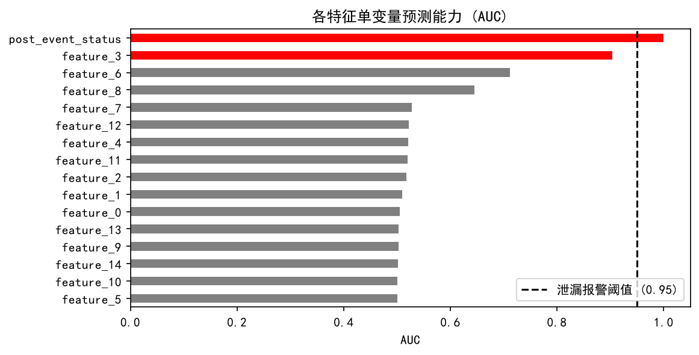

# 🩺 DQ-Doctor

**建模感知（Modeling-Aware）的数据质量诊断 Agent**

[](https://github.com/shenghuoxuejia/dq-doctor/actions/workflows/ci.yml)


传统的数据质量工具告诉你「缺失率 35%」「存在 ID 列」。DQ-Doctor 面向**建模前（Pre-modeling）**场景，回答的是：

> **这个缺失是信息性的，直接删会引入选择偏差。**
> **这个特征单变量 AUC 就到 0.98 —— 上线必崩，先去核实时点可得性。**

诊断由**确定性统计检验**完成，再由 LLM 把结果翻译成业务语言；**没有 API Key 时自动降级为规则引擎**，功能不中断。

---

## 📸 效果示例



> 泄漏扫描的中间产物：每个数值特征单独训练逻辑回归后的交叉验证 AUC。
> `post_event_status` 越过 0.95 阈值被判为泄漏候选 —— 它在事件发生后才产生，
> 建模时根本拿不到。剔除后交叉验证 AUC 从 **1.000 降到 0.910**（见 [benchmarks/RESULTS.md](benchmarks/RESULTS.md)）。

界面截图请见 `docs/screenshots/`（运行 `streamlit run app.py` 后自行截取放入即可）。

---

## ✨ 核心能力

| 模块 | 方法 | 产出 |
|---|---|---|
| **缺失模式诊断** | Little's MCAR 检验（手写实现） | 全局机制：MCAR / 非 MCAR |
| **信息性缺失（MNAR 嫌疑）** | 二分类用 χ²+Cramér's V，连续型用 point-biserial，**BH-FDR 多重比较校正** | 哪些列的"是否缺失"本身携带标签信息 |
| **数据泄漏扫描** | 单特征 ROC-AUC（双向取 `max(auc, 1-auc)`）、高基数 ID 检测、同源特征聚类去重 | 泄漏候选 + 常量/ID 列 + 建议处置 |
| **LLM 业务洞察** | DeepSeek（兼容 OpenAI 协议） | 按威胁度排序的诊断报告，会主动质疑"后见之明偏差" |
| **无 Key 降级** | 规则引擎 | 同样可读、可执行的结论，不依赖网络 |

设计上刻意做了几件"反 AI 直觉"的事：

- **诚实跳过**：目标列是多分类/回归时，明确返回 `skipped` 并说明"本次未执行泄漏扫描"，而不是硬凑一个 AUC。
- **拒绝无中生有**：数据确实干净时直接返回确定性结论，**不调用 LLM**，杜绝"为了显得有用而虚构风险"。
- **误报留给人**：高 AUC 只是"数学候选"，报告里会要求核实时点可得性，而不是直接判死刑。

---

## 🏗️ 架构

```
        ┌──────────┐   ┌─────────────┐   ┌──────────┐   ┌────────────┐
CSV ──▶ │ profile  │──▶│ missingness │──▶│ leakage  │──▶│ synthesize │──▶ 报告
        └──────────┘   └─────────────┘   └──────────┘   └────────────┘
        行数/重复行     Little's MCAR      AUC/ID/常量    LLM 或规则引擎
        列清单          FDR 校正 MNAR      同源特征合并    确定性兜底
```

- **编排**：LangGraph `StateGraph`（线性链 + `Annotated` 归约合并诊断结果）
- **统计**：Pandas / NumPy / SciPy / statsmodels / scikit-learn
- **LLM**：LangChain + DeepSeek（OpenAI 兼容）
- **UI**：Streamlit

---

## 🚀 快速开始

```bash
git clone https://github.com/shenghuoxuejia/dq-doctor.git
cd dq-doctor

# 1. 安装（Python >= 3.10）
uv venv && uv pip install -e ".[dev]"
# 或用 pip： pip install -e ".[dev]"

# 2. 配置大模型（可选，不配也能跑，只是走规则引擎）
cp .env.example .env          # 填入 DEEPSEEK_API_KEY=sk-xxx

# 3. 启动界面
streamlit run app.py

# 4. 跑测试（不需要 API Key）
python -m pytest
```

### 命令行调用

```python
import pandas as pd
from dq_doctor.graph import build_graph

df = pd.read_csv("data/toxic_data.csv")
graph = build_graph()
result = graph.invoke(
    {"df": df, "target_col": "target", "diagnoses": {}, "messages": []},
    config={"configurable": {"thread_id": "demo-1"}},
)

print(result["severity_order"])       # ['leakage', 'missingness']
print(result["messages"][-1].content) # 诊断报告
```

---

## 📁 项目结构

```
dq-doctor/
├── app.py                      # Streamlit 界面
├── src/dq_doctor/
│   ├── graph.py                # LangGraph 编排 + DataFrame 序列化
│   ├── nodes.py                # LLM 节点：惰性构造 + 规则引擎降级
│   ├── state.py                # 状态定义
│   └── tools/
│       ├── missingness.py      # Little's MCAR + FDR 校正的 MNAR 检测
│       └── leakage.py          # AUC / ID / 常量列 / 同源特征扫描
├── tests/                      # 19 个测试，无需 API Key
├── benchmarks/                 # 案例研究：删除泄漏特征后 AUC 从 1.000 → 0.910
└── data/                       # 示例数据集（含真实乳腺癌数据集）
```

---

## 🧪 测试

```bash
python -m pytest          # 全部测试
ruff check .              # 代码检查
```

CI 在 Python 3.10 / 3.11 / 3.12 上运行，并且**刻意在无 `DEEPSEEK_API_KEY` 的环境下跑**——这是对"降级路径可用"的回归保护。

---

## ⚠️ 已知限制

诚实说明当前版本的边界：

- **仅支持二分类目标**。多分类/回归会显式跳过泄漏扫描（AUC 不适用），不会给出错误结论。
- **高 AUC ≠ 泄漏**。乳腺癌数据集的 `worst perimeter`（AUC 0.975）就是合法强特征。当前阈值（0.95）为硬编码，尚未提供误报率基准。
- **时序泄漏未覆盖**。`state.time_col` 已预留但尚未实现"未来信息"检测。
- **Little's MCAR 只能否证 MCAR**，无法区分 MAR 与 MNAR；"MNAR 嫌疑"来自缺失指示变量与标签的关联检验，属启发式判断。

---

## 🗺️ Roadmap

- [ ] 带标注的泄漏基准集 → 报告 TPR / FPR / 每类召回
- [ ] 阈值敏感性分析与可配置化
- [ ] 时序泄漏检测（利用 `time_col`）
- [ ] 回归目标支持（改用互信息 / 相关系数）
- [ ] `remediation` 字段：输出可执行的修复脚本

---

## 📄 License

[MIT](LICENSE)
